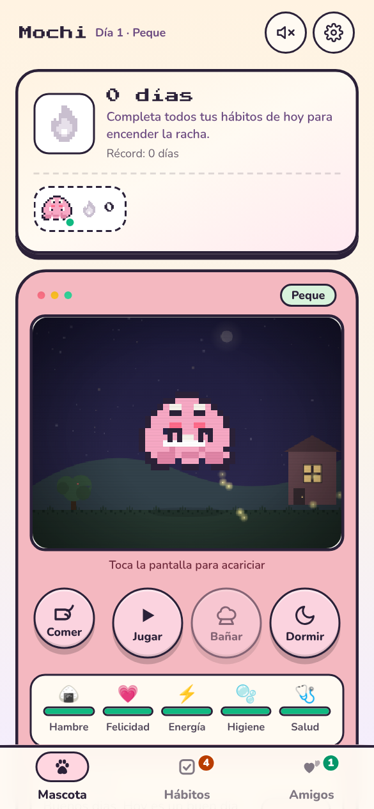
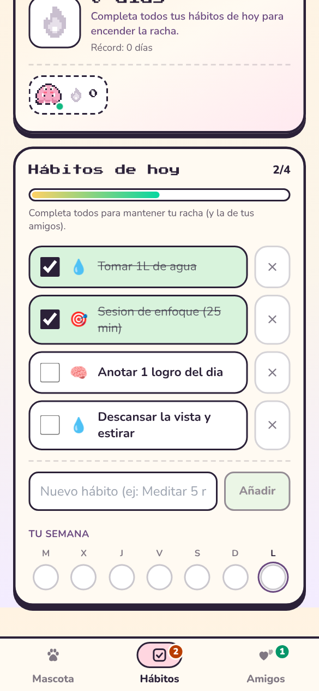
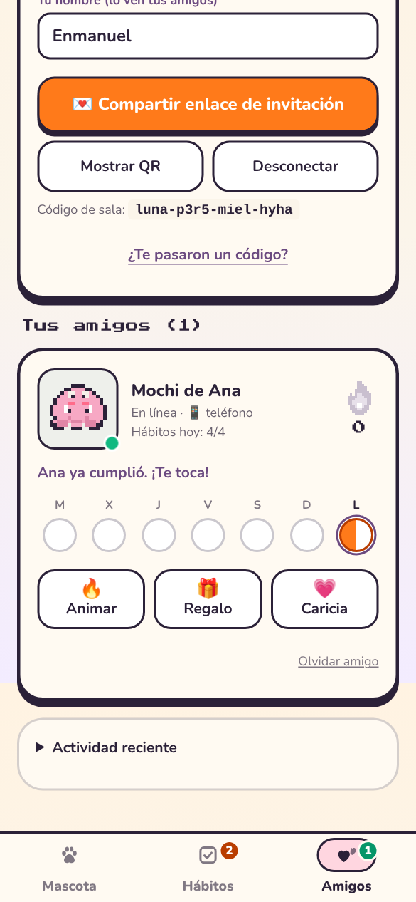
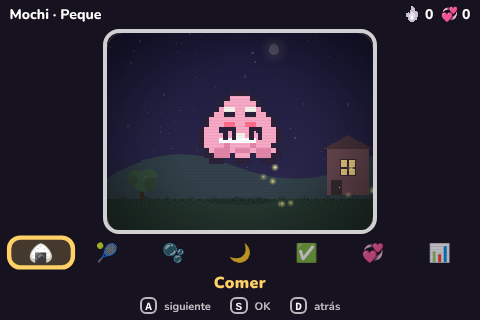
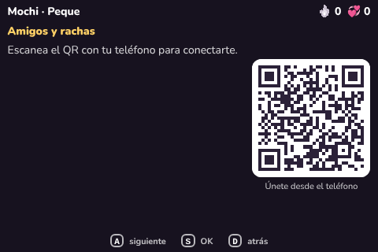

# Plan: Animo en el teléfono (PWA) + racha con amigos + maquinita

> Estado: **fase 1 implementada** en esta rama. Las fases 2 y 3 están abajo como próximos pasos.

## La idea en una frase

Abres un **enlace** desde WhatsApp, se instala en tu pantalla de inicio como una app
(sin tienda), cuidas tu mascota, cumples tus hábitos y **mantienes una racha con tus
amigos**. La misma app corre en la **Raspberry Pi** como una maquinita con 3 botones
físicos. Todo se conecta **P2P** (WebRTC), sin servidor propio.

```
  Teléfono (PWA)  ◄──── WebRTC P2P ────►  Teléfono de tu amiga (PWA)
        ▲                                         ▲
        └──────── WebRTC P2P ────► Raspberry Pi (Chromium kiosco, ?modo=maquina)
                 (sincronización P2P CRDT vía Yjs + y-webrtc + y-indexeddb)
```

## Cómo se ve en el teléfono

| Mascota | Hábitos | Amigos |
|---|---|---|
|  |  |  |

Estructura de cada pantalla (390 × 844, iPhone 12–15 / Android medio):

1. **Cabecera** — nombre de la mascota (toca para renombrar), `Día N · Etapa`, sonido y ajustes.
2. **Banner “Instala Pixel Pet”** — solo si aún no está instalada:
   - Android/Chrome: botón **Instalar** (prompt nativo).
   - iPhone/Safari: pasos “Compartir → Añadir a pantalla de inicio”.
3. **Tarjeta de racha** (en Mascota y Hábitos) — llama pixel con tres estados:
   - encendida = hoy ya cumpliste.
   - pálida y “respirando” = **en riesgo**: ayer cumpliste, hoy todavía no.
   - gris = sin racha.
   Debajo, avatares de tus amigos con su **racha compartida** (borde verde si los dos cumplieron hoy).
4. **Contenido de la pestaña.**
5. **Barra inferior** (zona del pulgar, respeta la “isla”/barra de inicio): Mascota · Hábitos (contador de pendientes) · Amigos (contador en línea).

### Paleta y estilo
Pixel art pastel con contorno grueso `#2b2138` (tinta), crema `#fbf5ea`, rosa `#f4b8c0`,
menta `#d8f3dc`, llama `#ff7a1a`. Títulos en *Press Start 2P*, texto en *Nunito* ≥ 12 px.
Las tarjetas tienen sombra “dura” de 6 px que da sensación de juguete.

## Racha con amigos — reglas

- **Tu racha**: días seguidos en los que completaste **todos** tus hábitos.
  Si hoy aún no cumples pero ayer sí, la racha sigue viva (“en riesgo”) hasta medianoche.
- **Racha compartida** con cada amigo: días seguidos en los que **los dos** cumplieron.
- Se calcula a partir del **historial de días** (`completedDays`, últimos 60), no de un
  contador. Cada mascota envía su historial por P2P y se hace la intersección. Por eso:
  - funciona aunque nunca estén conectados a la vez (basta con que se crucen un momento);
  - desmarcar un hábito quita el día de hoy sin romper nada;
  - cerrar la app días seguidos no corrompe el contador.
- Los días son **fecha local** (`YYYY-MM-DD`), no UTC: un hábito a las 23:00 cuenta para hoy.
- Amigo ya cumplió y tú no → “¡Te toca!”. Tú sí y él no → botón **Animar ** (le llega un aviso).
- Tira de 7 días por amigo: llama llena = ambos, media = solo uno, vacía = nadie.

Código: `src/game/streak.ts` (funciones puras, 14 tests en `streak.test.ts`).

## Invitar desde un enlace

1. Pestaña **Amigos → “Crear sala e invitar”**: genera un código tipo `luna-p3r5-miel-hyha`
   (~40 bits aleatorios) y abre la hoja de compartir del teléfono (o copia el enlace).
2. El enlace es `https://tu-app/?sala=<código>`. La vista previa en WhatsApp muestra
   `public/og.png` (“Toca para unirte”).
3. Tu amigo lo abre → se une solo a la sala, va directo a la pestaña Amigos y se limpia la URL.
4. También hay **QR** (para la Pi o para alguien a tu lado) y “¿Te pasaron un código?”.
5. La sala se recuerda: al volver a abrir la app se reconecta sola.

**Seguridad e Identidad Criptográfica**:
- **Cifrado de transporte**: el código de sala es la contraseña con la que Yjs cifra el handshake y canales WebRTC con AES-GCM.
- **Autenticación sin servidor**: cada dispositivo genera localmente un par de llaves ECDSA P-256 (`src/network/crypto.ts`) mediante Web Crypto API. La clave pública es la raíz de identidad y cada actualización, regalo o interacción se firma digitalmente con la clave privada.
- **Validación estricta**: las firmas se verifican criptográficamente antes de procesar cambios (`src/network/protocol.ts`). Números acotados, textos recortados, tipos desconocidos descartados, y máximo 1 regalo / interacción por amigo cada 30 s para prevenir abusos.

Identidad y Local-First: los datos se persisten localmente en IndexedDB vía `y-indexeddb` y
se sincronizan mediante CRDTs con `y-webrtc`. Los amigos se guardan por `playerId`.

## PWA instalable

| Pieza | Archivo |
|---|---|
| Manifest (nombre, colores, iconos `any` + `maskable`, atajos) | `public/manifest.webmanifest` |
| Iconos 192/512/maskable/apple-touch | `public/icons/` (fuente: `icon.svg`) |
| Service worker (offline: app shell + assets con hash) | `public/sw.js` |
| Registro solo en producción | `src/main.tsx` |
| Meta iOS, Open Graph | `index.html` |
| `og:image` absoluta (usa `SITE_URL` o el dominio de Vercel) | `vite.config.ts` |
| Cabeceras (sw sin caché, assets inmutables) | `vercel.json` |

Despliegue: Vercel o Cloudflare Pages (HTTPS automático, necesario para PWA y WebRTC).
`vercel.json` ya usa `pnpm install --frozen-lockfile` (el repo tiene `pnpm-lock.yaml`).

## La maquinita (Raspberry Pi)

| Inicio | Amigos (QR para unirse) |
|---|---|
|  |  |

- Se abre con `?modo=maquina` (se recuerda; `?modo=telefono` para volver).
- **3 botones**: **A** siguiente · **S** OK · **D** atrás (también flechas/Enter/Esc).
- Menú: Comer, Jugar, Bañar, Dormir, (Medicina si está enferma), Hábitos, Amigos, Estado.
- Barra superior: racha y amigos en línea. La opción enfocada se ve grande y en amarillo
  de alto contraste; los mensajes salen en un recuadro grande.
- En Amigos muestra un **QR**: escanéalo con el teléfono y quedan en la misma sala.
- **Voz** opcional (Estado → OK): lee en español la opción seleccionada.
- Pantalla siempre encendida (Wake Lock), sin cursor ni barras de scroll.
- Se adapta de 320×240 a 800×480 (tamaños en `vh`).
- La Pi tiene **su propia mascota** (como un Tamagotchi de verdad) y participa en la sala
  como un amigo más (aparece como “máquina”).

Instalación: ver [`machine/README.md`](../machine/README.md).

## Accesibilidad (checklist)

- [x] `lang="es"`, textos e `aria-label` en español.
- [x] Objetivos táctiles ≥ 44 px (botones principales 52–64 px).
- [x] Texto ≥ 12 px; colores de texto con contraste AA sobre crema.
- [x] El color nunca es la única señal: barras con `role="meter"` y valor hablado, la tira
      semanal tiene texto oculto por día, estados con texto (“¡Te toca!”).
- [x] Hábitos con `<input type="checkbox">` + `<label>` reales; botón de eliminar visible
      y etiquetado (antes solo aparecía con hover → invisible en móvil).
- [x] Barra de progreso con `role="progressbar"` y `aria-valuetext`.
- [x] Navegación con `aria-current="page"`; la pantalla de la mascota es un botón (“Acariciar a Mochi”).
- [x] Avisos (`role="status"`) para regalos, ánimos y racha; región `aria-live` del estado de la mascota.
- [x] `prefers-reduced-motion`: sin animaciones de pestañas, llama ni mini-mascotas.
- [x] Foco visible en botones, inputs y `<summary>`.
- [x] Máquina: manejable solo con 3 botones, alto contraste, opción de voz.

## Fases

### Fase 1 — hecha en esta rama
- PWA instalable + offline, iconos, vista previa para WhatsApp.
- Layout móvil con pestañas, tarjeta de racha, banner de instalación.
- Racha por historial + racha compartida por amigo + tira semanal.
- Invitación por enlace/QR/código, reconexión automática, nombre del dueño.
- Protocolo P2P v2 validado y con límite de spam; amigos persistentes.
- Modo máquina con A/S/D, voz, wake lock; scripts de kiosco y GPIO para la Pi.
- Bug arreglado: mascotas nuevas re-evolucionaban cada segundo (destello gris constante).

### Fase 2 — siguiente
- **Recordatorios con la app cerrada** (“tu racha está en riesgo ”): requiere Web Push,
  o sea un servidor mínimo (p. ej. Supabase Edge Function o Cloudflare Worker con VAPID).
  En iOS solo funciona con la PWA instalada (iOS 16.4+).
- Regalos dirigidos a un amigo concreto (hoy van a toda la sala).
- “Protector de racha” (1 día libre por semana) y recompensas por hitos (7, 30, 100 días).
- Vincular la máquina a la mascota del teléfono (transferir la partida por QR).

### Fase 3 — opcional
- Visitas: dibujar la mascota del amigo junto a la tuya en el mismo canvas.
- Tema oscuro, tamaño de texto ajustable, sonidos con vibración háptica.
- Pruebas E2E con Playwright de dos navegadores (el flujo ya se probó a mano así).

## Cómo probarlo

```bash
pnpm install
pnpm dev                     # http://localhost:5173
pnpm test                    # 44 tests
pnpm build && pnpm preview   # prueba la PWA real (service worker solo en build)
```

En el teléfono, en la misma red: `pnpm dev --host` y abre la IP que muestra
(para instalarla como PWA hace falta HTTPS → usa el deploy de Vercel).
